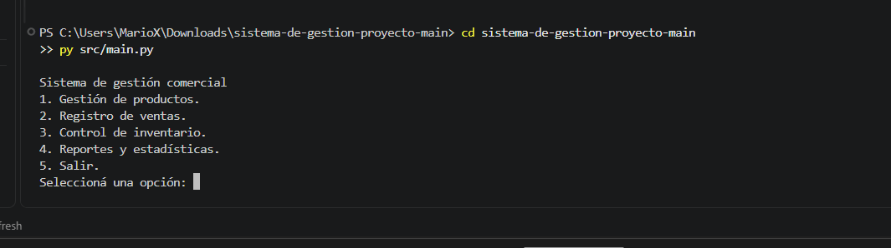
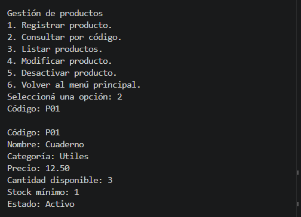
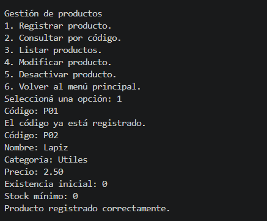
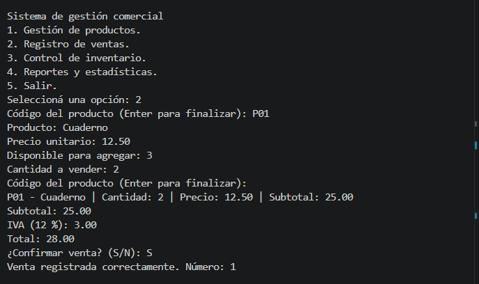
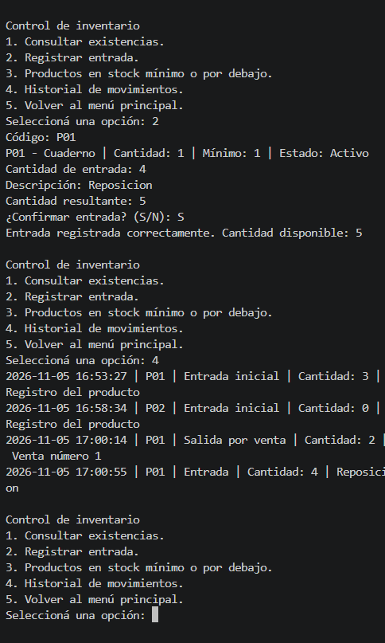
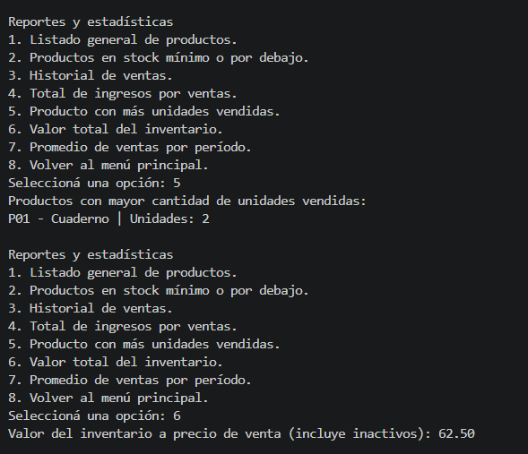
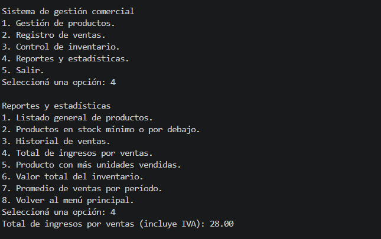

# Manual de usuario

## Para qué sirve

Este programa permite registrar productos, vender, revisar inventario y consultar reportes. Se usa desde la consola, escribiendo una opción y presionando Enter.

Los datos se conservan mientras el programa está abierto y se pierden al salir.

## Cómo iniciar y salir

Se necesita Python 3.9 o una versión más nueva. Para iniciar el programa, se abre una terminal en la carpeta del proyecto y se ejecuta:

```bash
python3 src/main.py
```

En Windows se puede usar `python` o `py` en lugar de `python3`. Los errores de zona horaria se explican en el [manual técnico](manual-tecnico.md).

| Opción principal | Qué hace |
| --- | --- |
| 1 | Gestión de productos. |
| 2 | Registro de ventas. |
| 3 | Control de inventario. |
| 4 | Reportes y estadísticas. |
| 5 | Salir. |

Para cerrar desde un submenú, se selecciona la opción de volver al principal y después la opción 5. No se pide confirmación al salir.

Menú principal del sistema.



## Productos

La opción 1 del menú principal abre el submenú de productos:

1. **Registrar:** ingresar código, nombre, categoría, precio, existencia inicial y stock mínimo. Ejemplo: `P01`, `Cuaderno`, `Útiles`, `12.50`, `3`, `1`.
2. **Consultar:** ingresar el código para ver sus datos.
3. **Listar:** ver todos los productos, incluidos los inactivos.
4. **Modificar:** ingresar el código y después los nuevos datos. Enter conserva el valor anterior de cada campo. El código y el estado no cambian. Los cambios se aplican al completar los campos.
5. **Desactivar:** ingresar el código y confirmar con `S`; `N` cancela. El producto permanece registrado, pero no se puede vender. No hay opción para reactivarlo.
6. **Volver al principal.**

El código no puede repetirse, aunque el producto esté inactivo. `p01` y `P01` son el mismo código. Código, nombre y categoría son obligatorios. El precio puede ser cero y usa punto decimal; existencia y stock mínimo deben ser enteros no negativos. El sistema vuelve a pedir los valores incorrectos.

Consulta de P01 y validación de código repetido.





## Ventas

La opción 2 del menú principal inicia una venta. Debe existir algún producto activo con stock.

1. Se ingresa el código del producto. El programa muestra el nombre, el precio y las unidades disponibles. Después se ingresa la cantidad a vender.
2. Se repite el paso para agregar otros productos. Si se repite un código, se acumula su cantidad.
3. Para terminar de agregar productos, se presiona Enter al solicitar otro código.
4. El programa muestra el subtotal, el IVA del 12 % y el total.
5. Se confirma con `S` o se cancela con `N`.

Las cantidades deben ser enteras, mayores que cero y no superar las existencias. Solo se descuenta inventario al confirmar. La venta recibe número y fecha; su detalle se consulta en reportes. Enter antes de agregar productos cancela una venta vacía. Después de la operación se vuelve al principal.

Venta de 2 cuadernos a 12.50: subtotal 25.00, IVA 3.00 y total 28.00.



## Inventario

La opción 3 del menú principal abre el submenú de inventario.

| Opción | Qué hace |
| --- | --- |
| 1 | Consultar existencias. |
| 2 | Registrar entrada: código, cantidad positiva y descripción; confirmar con `S` o cancelar con `N`. |
| 3 | Mostrar productos con cantidad igual o menor al stock mínimo. |
| 4 | Consultar movimientos con fecha, código, tipo, cantidad y descripción. |
| 5 | Volver al principal. |

El historial incluye el registro inicial, entradas, cambios de cantidad y salidas por ventas. Modificar la cantidad en productos registra un ajuste por la diferencia. Recibir unidades de un producto inactivo no lo reactiva. Las consultas de existencias y mínimos incluyen inactivos.

Entrada de 4 unidades y registro de movimientos. La existencia final de P01 es 5.



## Reportes

La opción 4 del menú principal abre el submenú de reportes.

| Opción | Qué muestra |
| --- | --- |
| 1 | Listado general de productos. |
| 2 | Productos en stock mínimo o por debajo. |
| 3 | Historial de ventas. |
| 4 | Ingresos por ventas, incluido IVA. |
| 5 | Productos con más unidades vendidas, incluidos empates. |
| 6 | Valor del inventario a precio de venta, incluidos inactivos; no es ganancia. |
| 7 | Ventas, ingresos y promedios diarios de un período. |
| 8 | Volver al principal. |

Para la opción 7 ingresar fechas reales con formato `YYYY-MM-DD`. La final no debe ser anterior a la inicial. Se cuentan ambos días y los días sin ventas. Enter en una fecha cancela. Para ver solo hoy, usar la fecha actual de Guatemala en ambos campos. Los reportes no cambian los datos.

P01 registra 2 unidades vendidas. Después de la reposición, el inventario vale 62.50. El reporte de ingresos muestra 28.00.





## Ejemplo

1. Registrar P01 como en el ejemplo de productos: precio 12.50, existencia 3 y mínimo 1.
2. Volver al principal y vender 2 unidades. Subtotal: **25.00**, IVA: **3.00**, total: **28.00**.
3. Consultar inventario: queda **1** unidad y aparece en stock mínimo.
4. Registrar una entrada de 4 unidades con descripción `Reposición` y confirmar. Quedan **5**.
5. Consultar reportes: ingresos **28.00**, unidades vendidas **2** y valor del inventario **62.50**.

Las [entradas y salidas del ejemplo](../evidencias/manuales/) están en el repositorio.

## Errores frecuentes

| Situación | Qué hacer |
| --- | --- |
| Opción incorrecta | Elegir un número del menú actual. |
| Campo obligatorio | Escribir un dato; no dejar solo espacios. |
| Código repetido o inexistente | Revisar el código o registrar otro producto. |
| Precio inválido | Usar un valor como `12.50`; no usar negativos, comas, signos, NaN, infinito ni notación científica. |
| Cantidad inválida | Usar enteros no negativos; para ventas y entradas deben ser positivos. |
| Producto inactivo o sin stock suficiente | Elegir otro producto o reducir la cantidad. |
| Respuesta inválida | Escribir `S` o `N`. |
| Fecha inválida | Usar una fecha real en formato `YYYY-MM-DD`. |
| Importe fuera de rango | Revisar precios y cantidades; usar valores menores. |
| No hay datos | Registrar productos o ventas antes de consultar. |

Cerrar la terminal o presionar Ctrl+C durante una operación puede terminar el programa. Al iniciar otra sesión las listas estarán vacías y la numeración de ventas comenzará otra vez en 1.
